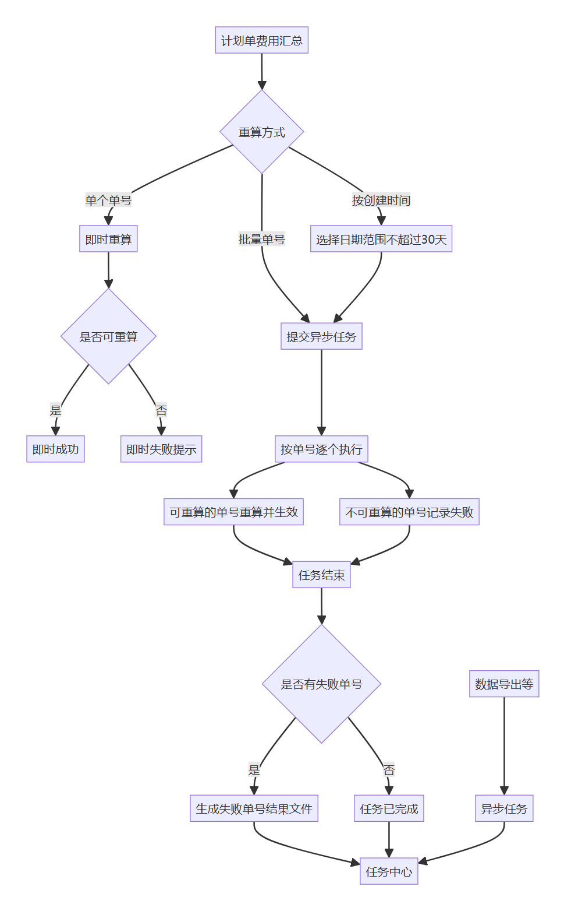
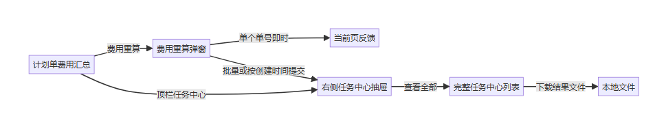
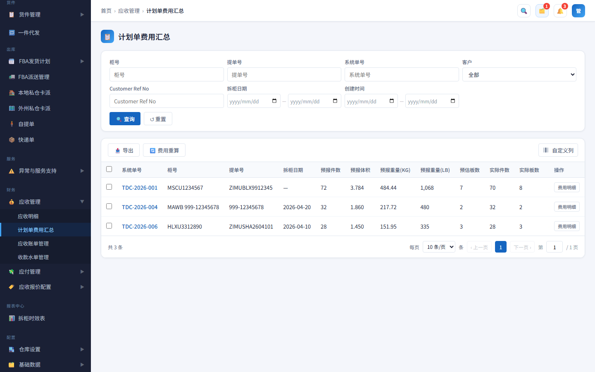
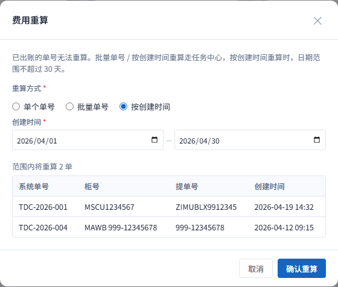
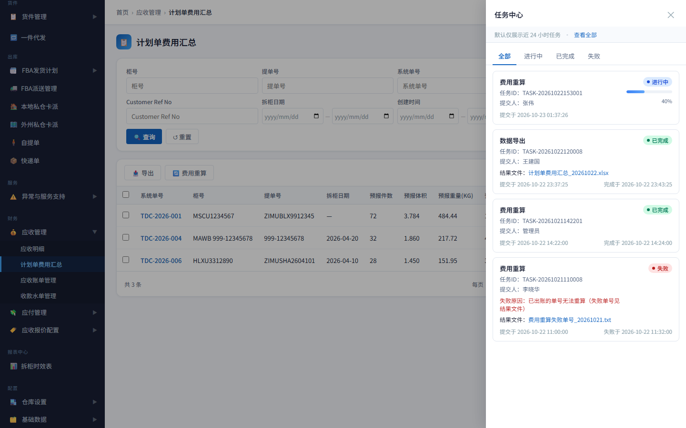
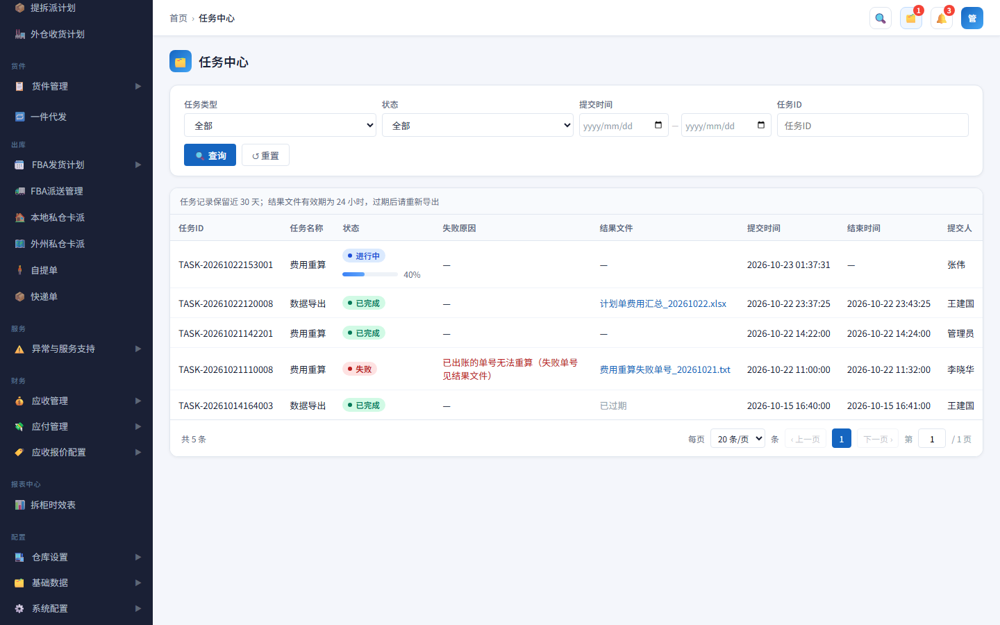

# 计划单费用重算与任务中心 — 产品需求文档 (PRD)

## 1. 文档说明

明确员工端「计划单费用汇总」的费用重算能力，以及全站统一的任务中心（异步任务进度、结果文件下载、历史查询）。

### 1.1 修订记录

| 版本号 | 修订日期 | 修订人 | 修订说明 |
|--------|----------|--------|----------|
| V1.0 | 2026-10-23 | — | 初稿 |

---

## 2. 产品概述

### 2.1 产品背景

计划单费用汇总需支持费用重算：单个单号可即时完成；批量或按创建时间耗时更长，不宜页面同步等待。导出等能力也需要统一的异步进度入口。因此引入任务中心——异步提交后可离开当前操作，在顶栏抽屉或完整列表中查看进度、失败原因与结果文件。

### 2.2 关联模块

| 关联模块 | 与本模块关系 |
|----------|--------------|
| 计划单费用汇总 | 费用重算入口；勾选可带入弹窗；批量 / 按时间提交写入任务中心 |
| 任务中心 | 全站异步任务统一入口与历史查询 |
| 其它含导出的业务页 | 导出任务同样进入任务中心，结果文件可下载 |

---

## 3. 业务流程与架构

### 3.1 核心业务流程图

*图 3.1 — 单个即时重算；批量 / 按创建时间提交异步任务后逐单执行（可重算则生效，不可重算则记录失败）；有失败单号时生成结果文件；任务中心展示进度与结果。*

### 3.2 页面流转图

*图 3.2 — 计划单费用汇总发起重算；异步任务经右侧抽屉查看，可进入完整任务中心下载结果文件。*

---

## 4. 需求详细说明

### 4.1 方案要点

1. 计划单费用汇总列表相对原页调整查询条件与表格列（见 §4.3.1），并增加导出、费用重算与勾选带入。
2. 费用重算三种方式：单个单号、批量单号、按创建时间。列表勾选 1 个 → 单个；多个 → 批量；未勾选 → 不带入。
3. 单个即时完成；批量 / 按创建时间走任务中心。
4. 批量 / 按创建时间：先校验再重算；任一失败则整批失败且不生效；失败原因见任务，失败单号见结果文件。
5. 按创建时间：日期范围不超过 30 天；预览表展示将重算的单据（含提单号）。

### 4.2 核心功能一览

| 序号 | 核心能力 | 关键功能点 | 详述 |
|:----:|----------|------------|------|
| ① | 列表页改造 | 查询与列调整；导出；勾选 | **4.3.1** |
| ② | 三种重算方式 | 单个 / 批量 / 按创建时间；勾选带入 | **4.3.2** |
| ③ | 即时与异步分流 | 单个即时；批量与按时间走任务 | **4.3.3**、**4.3.4** |
| ④ | 整批成败 | 先校验；任一失败整批不生效 | **4.3.4** |
| ⑤ | 失败单号可追溯 | 失败原因话术 + 结果文件 | **4.3.5** |
| ⑥ | 全站任务入口 | 抽屉 24h；列表 30 天；文件 24h | **4.3.6**～**4.3.8** |
| ⑦ | 任务结束提醒 | 完成 / 失败右下角 Toast | **4.3.9** |

### 4.3 具体功能详述

#### 4.3.1 计划单费用汇总列表（相对原页调整）

本需求对「计划单费用汇总」列表页做了调整，与原有页面不一致；实现与验收以本节及原型截图为准。

##### 查询条件

| 对比 | 内容 |
|------|------|
| 原页 | 系统单号、柜号、提单号、客户 |
| 本需求 | 柜号、提单号、系统单号、客户、拆柜日期、创建时间；展开更多：业务员、客服 |

说明：默认展示控制在两行内（桌面约 4 列 × 2 行）；再增条件须放入「展开更多」或与现有默认条件对调。

##### 工具栏

| 对比 | 内容 |
|------|------|
| 原页 | 费用重算 |
| 本需求 | 导出、费用重算 |

##### 列表列

| 对比 | 列（从左到右） |
|------|----------------|
| 原页 | 勾选、系统单号、柜号、客户、拆柜日期、Move Type、FBA Code、QTY(CTNS)、Vol(CBM)、GW(LBS)、预估板数、实际板数、Customer Ref No、FBA ID、拆柜备注、柜型、总费用、折合人民币、操作 |
| 本需求 | 勾选、系统单号、柜号、提单号、拆柜日期、拆柜备注、预报件数、预报体积、预报重量(KG)、预报重量(LB)、预估板数、实际件数、实际板数、柜型、货件数、总金额、折合人民币、业务员、客服、创建时间、操作 |

相对原页主要变化：

- **新增：** 提单号、预报件数 / 体积 / 重量(KG/LB)、实际件数、货件数、业务员、客服、创建时间；工具栏「导出」。
- **移除：** 客户列、Move Type、FBA Code、QTY(CTNS)、Vol(CBM)、GW(LBS)、Customer Ref No、FBA ID；「总费用」改为「总金额」。
- **保留：** 拆柜备注；行勾选 / 全选（用于费用重算带入）；操作列为「费用明细」，可右侧吸顶。

##### 与费用重算的关系

- 列表勾选仅用于打开费用重算弹窗时带入系统单号，不改变列表查询本身。
- 「按创建时间」预览依赖列表中的系统单号、柜号、提单号、创建时间等字段。

#### 4.3.2 费用重算弹窗

**入口：** 计划单费用汇总 → 工具栏「费用重算」。

**提示文案：**

> 已出账的单号无法重算。批量单号 / 按创建时间重算走任务中心，按创建时间重算时，日期范围不超过 30 天。

**重算方式（三选一）：**

| 方式 | 输入 | 提交后 |
|------|------|--------|
| 单个单号 | 一个系统单号 | 即时完成，不进任务中心 |
| 批量单号 | 多行粘贴，至少 2 个（空格 / 换行 / 逗号分隔，去重） | 异步任务 |
| 按创建时间 | 开始 / 结束日期；范围不超过 30 天 | 异步任务 |

**列表勾选带入：**

| 勾选情况 | 打开弹窗时 |
|----------|------------|
| 勾选 1 个 | 选中「单个单号」，带入该系统单号 |
| 勾选多个 | 选中「批量单号」，带入全部勾选单号 |
| 未勾选 | 默认「单个单号」，不带入 |

**按创建时间：**

- 日期控件限制可选范围：已选一端后，另一端仅能在不超过 30 天的窗口内选择。
- 预览表列：系统单号、柜号、提单号、创建时间；可限制预览条数并注明总数。
- 范围内无计划单时不可提交。

**业务约束：** 已出账的单号无法重算；单个仅允许一个单号，批量至少 2 个；填错方式时提示切换。

#### 4.3.3 单个单号即时重算

- 提交后关闭弹窗，即时给出成功或失败反馈。
- 不写入任务中心。
- 若该单号已出账等无法重算：即时失败提示，不生成任务。

#### 4.3.4 批量 / 按创建时间：异步、先校验、整批成败

| 规则 | 说明 |
|------|------|
| 提交 | 关闭弹窗，生成「费用重算」异步任务，可在任务中心查看 |
| 执行顺序 | 先校验，再重算 |
| 整批成败 | 只要有一个单号无法重算（如已出账），任务状态为失败，整批不生效 |
| 不做 | 部分成功、静默跳过、成功单回退 |
| 超时 | 进行中超过约定时长未完成 → 失败，失败原因为超时类说明 |

**任务状态（仅三种）：**

| 状态 | 含义 | 展示 |
|------|------|------|
| 进行中 | 后台执行中 | 状态标签 + 进度条（仅进行中，位于状态下方） |
| 已完成 | 整批校验通过且重算成功 | 状态标签 |
| 失败 | 校验未通过 / 执行失败 / 超时等 | 状态标签 + 失败原因；有失败单号时提供结果文件 |

#### 4.3.5 失败原因与失败单号结果文件

**失败原因话术（因已出账等校验失败时）：**

> 已出账的单号无法重算（失败单号见结果文件）

| 项 | 规则 |
|----|------|
| 适用 | 费用重算失败且存在失败单号时；以及数据导出等生成文件的任务 |
| 费用重算失败文件 | 如「费用重算失败单号_yyyyMMdd.txt」，内容含失败系统单号列表 |
| 展示 | 任务中心「结果文件」列展示文件名，可点击下载 |
| 有效期 | 自任务完成（或失败落文件）时起 24 小时；过期显示「已过期」，不可下载 |
| 无文件 | 结果文件列显示「—」 |

#### 4.3.6 右侧任务中心抽屉

| 项 | 规则 |
|----|------|
| 入口 | 全站顶栏（搜索与消息之间）；进行中任务显示角标数量（无进行中不显示角标） |
| 范围 | 仅展示近 24 小时内提交的任务 |
| 筛选 | 全部 / 进行中 / 已完成 / 失败 |
| 卡片信息 | 任务类型、任务 ID、提交人、状态；失败显示失败原因；有结果文件显示文件名（可下载） |
| 查看全部 | 跳转完整任务中心列表页 |

#### 4.3.7 完整任务中心列表

| 项 | 规则 |
|----|------|
| 查询 | 任务类型、状态、提交时间、任务 ID |
| 列表列 | 任务 ID、任务类型、状态（进行中时状态下附进度条）、失败原因、结果文件、提交时间、结束时间、提交人 |
| 说明文案 | 「任务记录保留近 30 天；结果文件有效期为 24 小时，过期后请重新导出」 |
| 无结果文件 | 结果文件列显示「—」 |
| 文件已过期 | 结果文件列显示「已过期」，不可下载 |

#### 4.3.8 保留与清理

| 对象 | 保留时长 | 说明 |
|------|----------|------|
| 结果文件 | 24 小时 | 过期清理文件；任务上标记已过期 |
| 右侧抽屉可见范围 | 近 24 小时 | 仅快捷入口 |
| 完整任务中心记录 | 近 30 天 | 到期清理或归档，列表不再展示 |

#### 4.3.9 异步任务结束提醒（Toast）

异步任务（费用重算批量 / 按创建时间、数据导出等）在状态变为终态时，须主动提醒用户，不依赖用户是否打开任务中心。

| 时机 | 提醒方式 | 文案要求 |
|------|----------|----------|
| 任务提交成功 | 右下角 Toast（成功） | 提示已提交，并可到右上角任务中心查看进度 |
| 任务已完成 | 右下角 Toast（成功） | 标明任务已完成，并带任务 ID |
| 任务失败（含超时） | 右下角 Toast（警告） | 标明任务失败、失败原因摘要，并带任务 ID |

说明：

- Toast 统一出现在页面右下角；用户已离开发起页时，仍须在当前页弹出。
- 任务中心列表 / 抽屉的状态、失败原因、结果文件更新与上述提醒并行，不互相替代。
- 单个单号即时重算不走任务中心，仍按 §4.3.3 当场反馈，不适用本表「完成 / 失败」任务 Toast。

---

## 5. 界面与交互需求

界面以现有原型为准；本节仅列与业务相关的要点。

### 5.1 界面要点

- 列表查询条件与列以 §4.3.1 为准，不得按原页列原样实现。
- 三种重算方式用单选项区分；切换时展示对应输入区。
- 按创建时间：30 天限制落在日期控件可选范围，不依赖文案提示超限。
- 预览表含提单号列。
- 顶栏任务中心：无进行中任务时不显示角标「0」。
- 进度条仅「进行中」显示，放在状态标签下方。
- 异步任务提交 / 完成 / 失败须右下角 Toast 提醒，规则见 §4.3.9。

### 5.2 功能界面截图

（辅助对照；业务规则以 §4 为准。）

#### 5.2.1 计划单费用汇总列表

*图 5.2.1 — 调整后的计划单费用汇总列表；工具栏含导出与费用重算；可勾选带入。*

#### 5.2.2 费用重算弹窗（单个单号）

*图 5.2.2 — 三种方式；默认单个单号；提示文案含任务中心与 30 天说明。*

#### 5.2.3 费用重算弹窗（按创建时间）

*图 5.2.3 — 创建时间 + 预览（系统单号 / 柜号 / 提单号 / 创建时间）；日期范围不超过 30 天。*

#### 5.2.4 任务中心抽屉

*图 5.2.4 — 右侧抽屉仅近 24 小时；失败原因与结果文件展示。*

#### 5.2.5 完整任务中心列表

*图 5.2.5 — 完整列表保留近 30 天；失败原因话术与失败单号结果文件；上方说明有效期与保留策略。*

---

## 6. 非功能性需求

| 项 | 要求 |
|----|------|
| 可用性 | 异步任务提交后可离开当前页，进度不依赖原弹窗 |
| 可理解性 | Toast 统一右下角；异步任务提交 / 完成 / 失败须提醒（见 §4.3.9）；失败有可读失败原因；失败单号可下载 |
| 一致性 | 不做部分成功，避免状态语义复杂 |
| 存储 | 结果文件与任务记录按 §4.3.8 清理 |

---

## 7. 数据统计与埋点需求

### 7.1 业务数据监控

### 7.2 埋点需求清单

---

## 8. 上线与运维计划

| 项 | 说明 |
|----|------|
| 清理任务 | 上线后配置定时清理：结果文件超 24 小时、任务记录超 30 天 |
| 超时参数 | 正式环境「进行中超时」时长与业务约定后配置，勿沿用原型演示秒级超时 |
| 校验与重算 | 正式环境须保证「先校验、整批不生效」与文件中失败单号一致 |
